# Easy-platform-tools-GUI

Windows 上的 adb / fastboot 图形化命令台。深色界面、、可换背景配色，
编译出来就是一个 98 KB 的单文件 exe，不需要装 PowerShell 模块、不需要运行库。

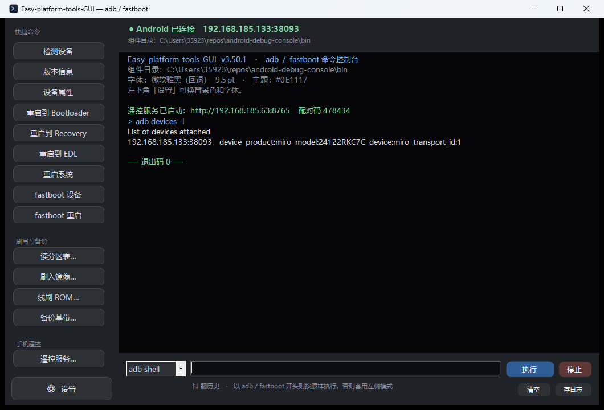

## 特性

- **左侧快捷命令**：检测设备、版本信息、设备属性、重启到 Bootloader / Recovery / EDL、重启系统、fastboot 设备、fastboot 重启
- **读分区表**：`fastboot getvar all` 列出真实分区名与大小，一键带入刷写对话框
- **刷入镜像**：任选分区 + 任意 `.img`，二次确认后刷入，可选刷完重启
- **线刷 ROM**：直接吃小米 fastboot 线刷包（`.tgz` / `.zip` / 已解压目录），自动解析 `flash_all.bat` 的刷写顺序
- **备份基带**：把 modem / modemst1 / modemst2 / fsg / fsc 等分区导出成本地镜像，附 SHA256 与设备信息
- **首次启动自动装依赖**：检测到没有 adb 时，自动从镜像/官方源下载 platform-tools 并解压到 `bin\`
- **拖文件进窗口**：从资源管理器把 `.img` / `.tgz` / 任意文件拖进主窗口，路径自动填到命令框；拖到各工具对话框的路径框也会直接填上
- **命令控制台**：底部按模式输入（`adb shell` / `adb` / `fastboot`），以 adb / fastboot 开头的命令按原样执行，↑↓ 翻历史
- **输出分色**：stdout 正文色、stderr 红色、结束时打印退出码（0 绿 / 非 0 红），可清空、可存日志
- **主题**：8 个预设背景色 + 自定义取色器，按背景亮度自动推导整套配色，浅色底不会出现浅色字
- **字体**：内置 MiSans / MiSans Medium / JetBrains Mono，另可选择系统里的微软雅黑、等线、宋体、黑体、Consolas，字号 4 档
- **编码处理**：设备返回的是 UTF-8，adb 自身的提示是 ANSI(GBK)，逐行判定解码，中文路径不乱码
- **零依赖**：`csc.exe`（.NET Framework 4.x 自带）直接编译，无第三方库、无 NuGet、无运行时安装

## 快速开始

1. 到 [Releases](../../releases) 下载 `Easy-platform-tools-GUI-v1.5.0.zip` 并解压
2. 双击 `Easy-platform-tools-GUI.exe`
3. 首次启动会提示缺少 **Android platform-tools**，点「立即下载」即可，程序自动下载并解压到 `bin\`

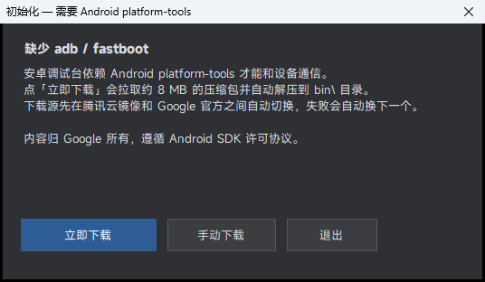

不想让程序联网就点「手动下载」跳转官方页面，把 `adb.exe`、`fastboot.exe`、
`AdbWinApi.dll`、`AdbWinUsbApi.dll` 放进 `bin\`，再点「重新检测」。

组件查找顺序：`exe 同级 bin\` → `上级 bin\` → `exe 所在目录` → `C:\platform-tools` → `PATH`。
整个文件夹可以整体挪走，只要 `bin\` 跟着走。

### 下载源

程序不打包 platform-tools（分发受 Android SDK 许可限制），改为首次运行时按顺序尝试：

| 顺序 | 源 | 说明 |
|---|---|---|
| 1 | 腾讯云镜像 `mirrors.cloud.tencent.com/AndroidSDK` | 与官方文件 SHA256 一致，国内通常最快 |
| 2 | Google 官方 `dl.google.com/android/repository` | 原始来源 |
| 3 | Google CDN `redirector.gvt1.com` | 官方备用线路 |

任一源失败自动换下一个。下载后会校验：必须是有效 zip、体积合理、压缩包里确实有 `adb.exe`。
想指定自己的镜像或走代理，在 `config.ini` 里加：

```ini
pt_source=https://your-mirror/platform-tools-latest-windows.zip
proxy=http://127.0.0.1:7897
```

## 刷写与备份

左侧「刷写与备份」一栏有四件工具，写盘类操作都会先弹确认。

### 读分区表

`fastboot getvar all` 拉出这台设备真实的分区列表（名称 / 大小 / 类型），可复制、导出 CSV，
选中一行点「用于刷入镜像」会直接带进刷写对话框——不用再手打分区的名字，也就不会打错。

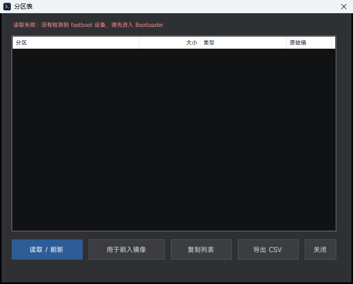

### 刷入镜像

任选分区（读过分区表就用真实分区名，否则用内置的 40 个常用名，也可以手填），
挑一个 `.img` 刷入，可选刷完自动重启。

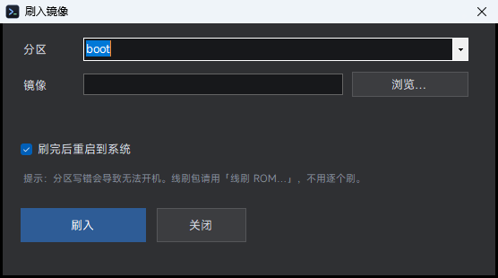

### 线刷 ROM（小米 fastboot 包）

直接选 `.tgz` / `.zip` 线刷包，或已解压的目录。程序会：

1. 自动解压（用系统自带 `tar.exe`）
2. 找到 `flash_all.bat`，**按它里面的顺序**解析出 `fastboot flash` / `erase` / `set_active` / `reboot`
3. 列出全部操作供核对，再逐条执行

没有 `flash_all.bat` 时退化为「把 `images\` 下每个 `.img` 刷到同名分区」。
可勾选是否擦除 userdata、刷完是否重启。

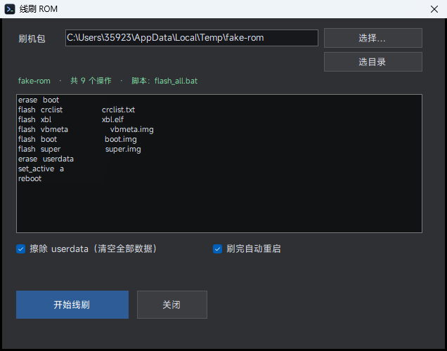

### 备份基带

勾选要备份的分区（默认 modem / modemst1 / modemst2 / fsg / fsc），导出到
`backups\基带备份-时间戳\`，同时写一份 `备份说明.txt`，含设备型号、序列号、每个文件的大小与 SHA256。

需要手机已 root（`adb shell su` 可用）。读取走
`adb exec-out su -c "dd if=/dev/block/by-name/xxx bs=1M"`，不落临时文件，二进制安全。

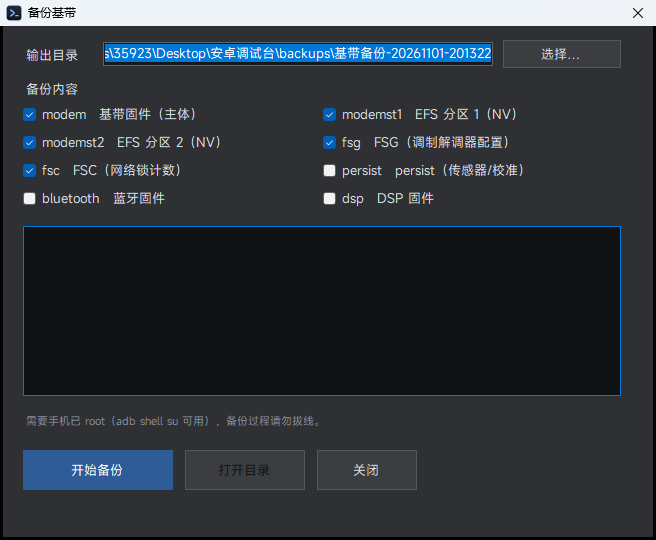

> 备份里含设备 NV / IMEI 等身份数据，能用来恢复**本机**，但不要外传。

## 关于 EDL

「重启到 EDL」先试 `adb reboot edl`，失败再试 `fastboot oem edl`。进入后手机黑屏无反应，
设备管理器里出现 `Qualcomm HS-USB QDLoader 9008` 即为成功。
多数机型进 EDL 需要已解锁 Bootloader 或厂商授权账号，失败时会如实报出来。

## 界面语言 / Language

左下角「设置 / Settings」里有语言下拉：**中文 / English**，切换后程序自动重启生效，
选择写进 `config.ini` 的 `lang=` 项。

| 中文 | English |
|---|---|
|  | 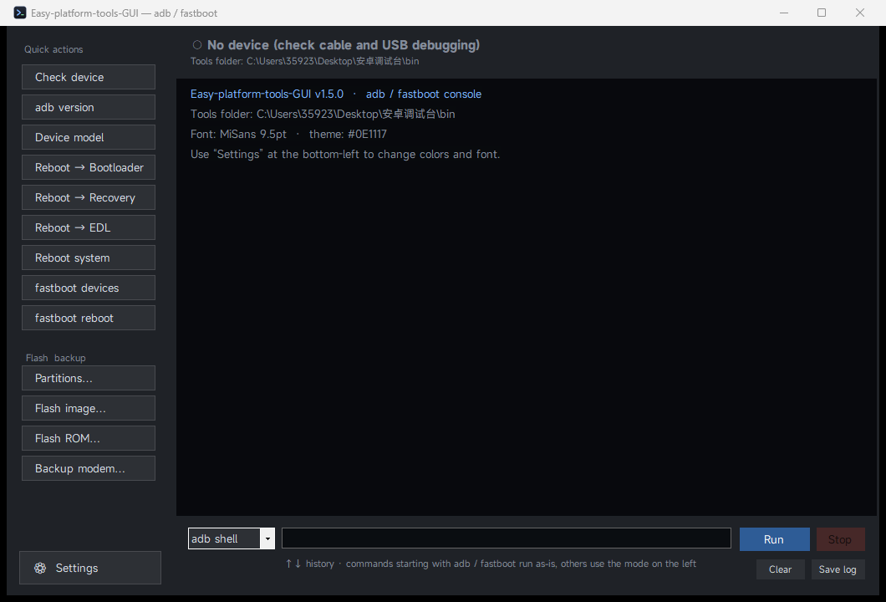 |

翻译覆盖主窗口、设置、首次启动向导、读分区表、刷入镜像、线刷 ROM、备份基带
全部界面与提示；未收录的文案会原样显示中文，不会报错。

## Android 版

同一个仓库里带一个 Android App（`android/`），三种模式在设置里自由切换：

| 模式 | 干什么 | 前提 |
|---|---|---|
| **OTG 主机** | 手机 A 用 OTG 线刷手机 B：读分区表、刷镜像、擦除、重启 | 目标机进 fastboot；本机需支持 USB Host |
| **本机 root** | 不用电脑，直接备份基带、刷自己分区、进 Recovery / EDL | 本机需 root |
| **遥控 PC** | 手机当遥控器，指挥电脑上的桌面版干活 | 同一 Wi-Fi，电脑开着并启动遥控服务 |

OTG 模式是**自己实现的 fastboot 协议**（USB bulk 传输 + 64 字节命令包），不依赖 adb、不需要 root。
遥控模式在桌面版「遥控服务…」里启动，配对码 6 位，服务只接受带正确 `X-Token` 的请求。

### 功能对照

| 功能 | 桌面版 | Android 版 |
|---|---|---|
| 读分区表 + 复制 + 导出 CSV | ✅ | ✅ |
| 刷入镜像（任意分区 / 任意 img） | ✅ | ✅ |
| 线刷 ROM（解析 `flash_all.bat`） | ✅ | ✅ |
| 备份基带（多选分区 + SHA256） | ✅ | ✅ |
| 重启 Recovery / Bootloader / EDL | ✅ | ✅（OTG / 本机 / 遥控） |
| 命令控制台 + 历史 | ✅ | ✅ |
| 日志分色 + 存日志 | ✅ | ✅ |
| 8 套配色 / 字号 / 中英文 | ✅ | ✅ |
| 遥控服务（被控端） | ✅ | —（App 是控制端） |
| 按键边框（彩虹 / 自定义色 + 粗细 + 不透明度） | — | ✅ |
| 界面样式（原生 / Material / MIUIX / 液态玻璃） | — | ✅ |

差别只在形态：桌面版连 USB 用 adb/fastboot 命令，Android 版要么自己说 fastboot 协议（OTG），
要么用 root 直接读写分区（本机），要么让电脑代劳（遥控）。

### 安装

下载 Release 里的 `EasyPT.apk` 直接安装（minSdk 26 / Android 8.0+）。
自签名 APK，首次安装需允许「未知来源」。

### 自己编译

```bat
powershell -ExecutionPolicy Bypass -File android\build-apk.ps1
```

不需要 Gradle：脚本直接用 `aapt2` + `javac` + `d8` + `apksigner` 打包，
默认找 `C:\Users\35923\android-build` 下的 build-tools / platform / jdk。

## 自定义壁纸与透明度

两端都支持把任意图片设成界面背景，并且按键底板透明度可调。

**桌面版**：设置 → 背景图 → 选择图片…；图片**等比铺满后居中裁切**（不再拉伸变形），
压暗后铺在窗口上，侧栏/顶栏/底栏按窗体坐标对齐贴同一张图。
旁边有「按键透明度」滑杆（0–100%），实时预览，存进 `config.ini` 的 `wall=` 与 `alpha=`。

**Android 版**：设置 → 背景图 → 选择图片…，进入裁剪界面：**单指拖动、双指缩放**。
裁剪框会先读取**本机真实分辨率**（含状态栏/导航栏），按屏幕比例摆好，所以裁出来的图正好铺满、不会拉伸。
设置里同样有「按键透明度」滑杆，按钮和日志区一起变。

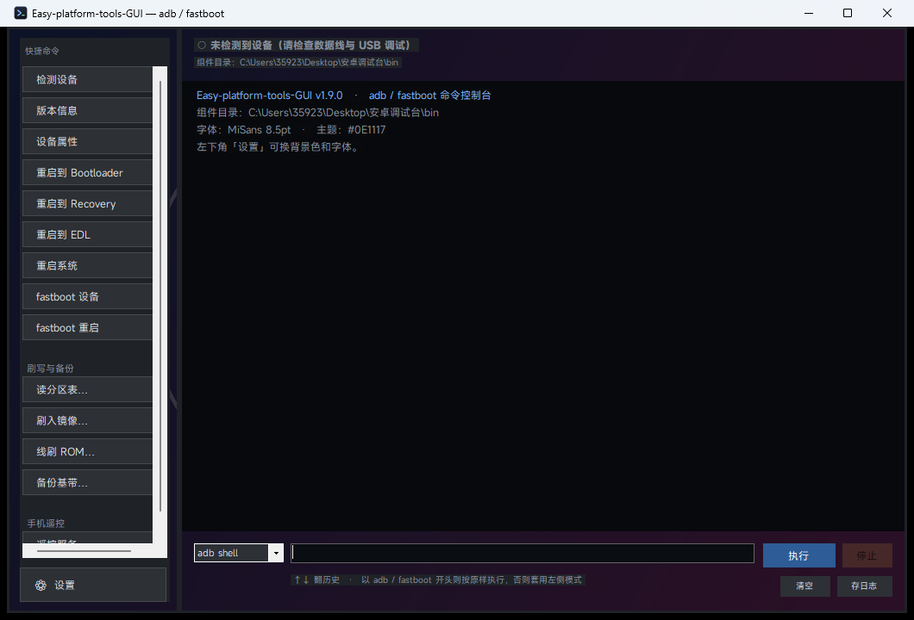

## 按键边框（Android 2.5.0）

设置 → 按键边框，给每颗按钮描一圈边。默认是**彩虹渐变**：沿按钮对角线铺 6 段色标，
每颗按钮按自己的尺寸重新起止，所以长按钮和短按钮都是完整一条色带。

| 选项 | 说明 |
|---|---|
| 彩虹（默认） | 6 段渐变，对角线方向 |
| 7 个预设 | 白 / 近黑 / 蓝 / 绿 / 黄 / 紫 / 粉 |
| 自定义… | R/G/B 三根滑杆 + 实时色块 + `#RRGGBB`，点确定即生效 |
| 无 | 关掉边框 |
| 粗细 | 1–6 dp |
| 不透明度 | 0–100%，**和按钮底色分开** |

边框不跟着底色透明度走：把按钮透明度拉到 20% 甚至 0%，边仍然是实的，按钮轮廓还在，
面板也不至于糊成一片。设置存在 SharedPreferences（`bOn` / `bRain` / `bCol` / `bDp` / `bA`），重启保留。

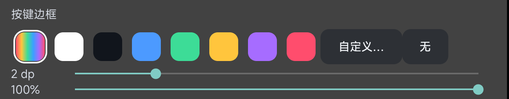

## 界面样式与底栏（Android 2.7.0）

界面分两页：**主页**（日志 / 快捷按钮 / 命令输入）和**设置**（上面所有开关），用底栏切换。
设置不再是弹窗，不再盖住主界面；底栏常驻，命令输入框就贴在底栏上方。

| 样式 | 长什么样 | 实现 |
|---|---|---|
| **原生** | 10 dp 圆角、半透明底、你选的边框 | `PillDrawable` |
| **Material** | 24 dp 药丸、底色往主色带、2 dp 投影、按下有水波纹 | `RippleDrawable` + `setElevation` |
| **MIUIX** | 单列列表：左边标题、右边 `›`、52 dp 行高，设置页也分成卡片 | 自绘 `ChevronDrawable` |
| **液态玻璃** | 卡片、按钮、底栏都是玻璃：预模糊壁纸 + 透镜边 + 高光 | `GlassDrawable` |

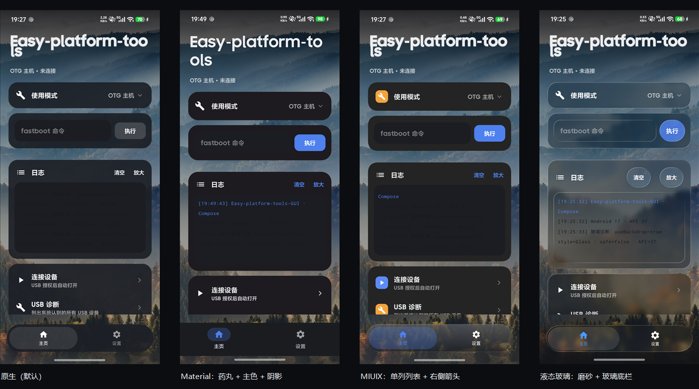

### 底栏的「液态」滑动

底栏两个 tab（主页 / 设置），选中的滑块用 `OvershootInterpolator(1.7)` 走 420 ms：
位移过冲再回弹，同时按 `sin(πt)` 横向拉伸到 1.22 倍再收回——看起来像一块**被拽着走的软玻璃**。
其余三套样式用 `DecelerateInterpolator` 240 ms 平推，幅度 0.05，不抢戏。

**按住也能拖**：手指按在滑块上左右拖，滑块跟着走、被拉长到 1.14 倍；松手按中线吸附到最近的 tab
（`onInterceptTouchEvent` 超过 7 dp 才接管，所以单击 tab 仍然走点击）。

底栏和 tab 的文字颜色都按**自己背后的实际底色**算（`localBackdrop` + WCAG），
所以浅色壁纸下是深色字、深色壁纸下是白字，滑块和底栏分开算。

## 弹窗（Android 2.8.0）

「使用模式 / 当前样式 / 字号 / 语言」不再用系统的 `AlertDialog` + 单选列表，
换成 MIUIX 那种**贴着选项浮出来的圆角卡**：

| 特性 | 说明 |
|---|---|
| 锚定 | 从被点的那一行下方弹出，下方放不下自动翻到上方 |
| 结构 | 标题 + 副标题两行；无分隔线，只靠留白 |
| 选中 | 主色文字 + 右侧 ✓，行底还有一层 8% 主色 |
| 动效 | 92% 缩放 + 淡入，150 ms |
| 位置 | **贴右边**浮出（不压住左边的正文），上下按空间自动翻 |
| 宽度 | 300 dp，超宽屏也不会拉满 |

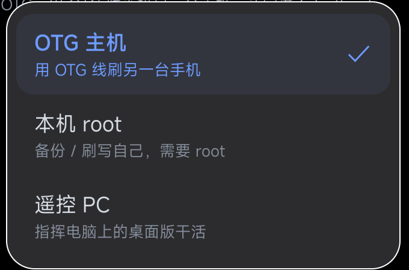

四套样式都有对应皮：MIUIX 是 `#2C2C2E` 卡片 + 蓝色主色，Material/原生是主题面板色 + 细描边，
玻璃是实时模糊的 `GlassDrawable`（见下一节）。弹窗都是在下一帧才 `show`，否则手指抬起会被当成「点外部」立刻关掉。

### 玻璃是怎么画的

先把壁纸按 1/3、1/6、1/12、1/24 烤成 4 张模糊小图（各做一次 3×3 盒滤），存在内存里。
`draw()` 里只做一件事：按控件**当前屏幕位置**从对应级别里取一块 `drawBitmap` 出来。

所以滚动时每帧重画也不掉帧（一次绘制 vs 以前的「新建位图 + 盒滤」）。
每块玻璃糊的都是它自己背后那块，换壁纸、滚动、挪位置都对得上。

叠在模糊底之上的是三层「液态」特征：

1. **透镜边**：把同一块图放大 1.18 倍，只留在外圈 9 dp 的环里——边缘就有玻璃折射的放大感
2. **顶部高光**：从上往下 18% 白的渐变
3. **底部压暗 + 1 px 亮边**：玻璃的厚度和反光

设置里有两根滑杆，都实时生效，不用重建界面：

| 滑杆 | 作用 | 默认 |
|---|---|---|
| **玻璃模糊** | 降采样倍率（1×–25×），越高越糊 | 80% |
| **玻璃浓度** | 面板不透明度 0–100%，越高壁纸越看不清 | 45% |

两者都写在 `GlassDrawable.BLUR` / `GlassDrawable.CONC` 静态字段上，改完把当前所有玻璃控件 `invalidate()` 一次即可。

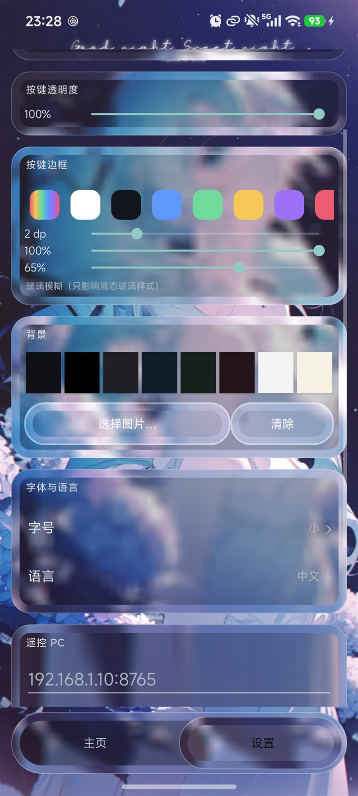

设置页也是玻璃卡片，卡片底比按钮重一些（0x6B alpha），保证标题和正文在花壁纸上也读得清。

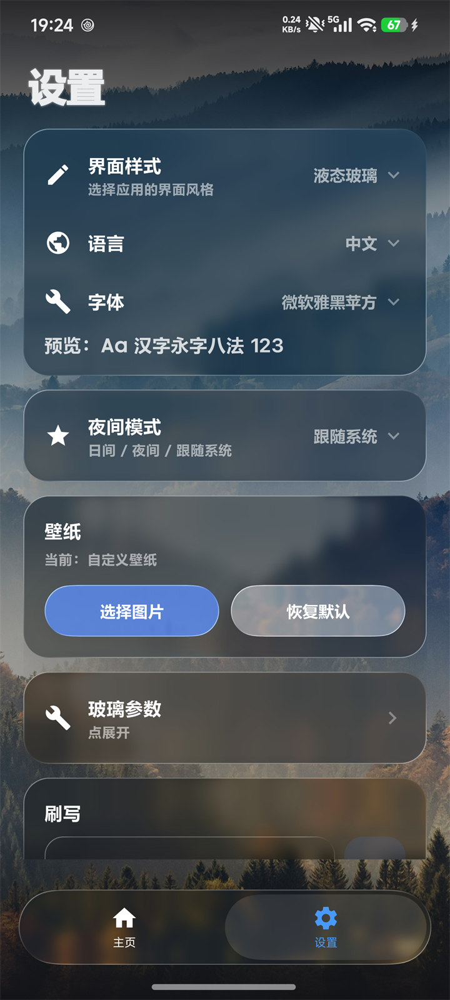

### 借鉴的开源项目

样式是按各家设计语言自己重画的，**没有拷贝代码**：

| 项目 | 借了什么 |
|---|---|
| [compose-miuix-ui/miuix](https://github.com/compose-miuix-ui/miuix) | MIUIX 列表行规范（行高、左右留白、箭头位置） |
| [Glasmio](https://github.com/NEORUAA/Glasmio) | 液态玻璃的层次：底色 / 模糊 / 雾 / 高光 / 描边 |
| [liquid-glass-compose](https://github.com/muhammadalkady/liquid-glass-compose) | AGSL 折射的思路（本项目只用简化版，没上 shader） |

这几个都是 Compose 库，本项目不走 Gradle、不引依赖，所以只参考观感。

## 字体

仓库**不包含**字体文件（授权原因）。想要截图里的效果，把字体放进 `assets\fonts\` 即可，
程序启动时用 `PrivateFontCollection` 私有加载，不会装进系统字体目录：

| 字体 | 用途 | 获取 |
|---|---|---|
| MiSans | 默认界面字体 | <https://hyperos.mi.com/font/zh/download/> |
| JetBrains Mono | 等宽西文，控制台对齐用 | <https://www.jetbrains.com/lp/mono/> |

一个字体都没放时，会自动回退到「微软雅黑 / 等线 / 宋体」中存在的第一个，不会掉到西文系统字体上。

## 主题与设置

点左下角「⚙ 设置」：

- **背景配色**：8 个预设（墨黑 / 纯黑 / 石墨 / 深海 / 墨绿 / 酒红 / 灰白 / 米黄）+ 自定义取色
- **字体**：字体下拉 + 字号下拉，下方有实时预览

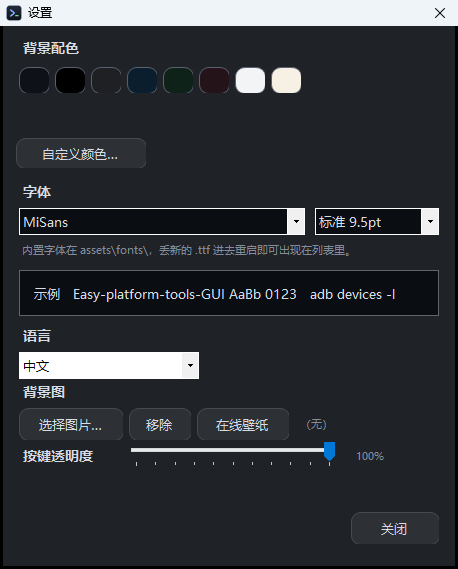

选择结果写入程序目录下的 `config.ini`：

```ini
bg=#0E1117
font=MiSans
size=9.5
```

换成等宽字体后，控制台输出是这样：

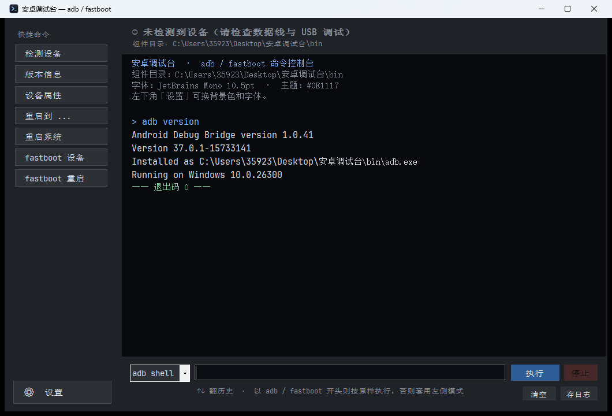

## 构建

```bat
powershell -ExecutionPolicy Bypass -File src\build.ps1
```

- 只用 .NET Framework 4.x 自带的 `C:\Windows\Microsoft.NET\Framework64\v4.0.30319\csc.exe`
- 产物是同目录的 `Easy-platform-tools-GUI.exe`
- 图标由 `src\make-icon.ps1` 生成 `src\app.ico`
- `src\shot.ps1` 是开发期截图脚本（启动 exe → 输入命令 → PrintWindow 存 PNG）

## 命令行参数

```bat
Easy-platform-tools-GUI.exe --version                  :: 版本与仓库地址
Easy-platform-tools-GUI.exe --selftest                 :: 打印组件解析、字体、主题、控件数
Easy-platform-tools-GUI.exe --run "adb devices -l"     :: 不开窗口跑一条命令并输出
```

`--selftest` / `--run` 可加 `--out <文件>` 把结果写进文件（在无控制台的宿主里很有用）。

## 附带脚本：HakiOS 一键刷入

`scripts\hackios-boot.ps1` 是把 XNU 内核 + iOS 用户态纯内存启动到 raphael 的刷入脚本，
配套 `一键启动HakiOS.bat` 使用。**仓库不包含镜像文件**（UEFI 与 APFS 镜像各 2 GB 量级），
需要自备后用参数指定：

```bat
powershell -ExecutionPolicy Bypass -File scripts\hackios-boot.ps1 -Uefi <uefi.img> -Apfs <system.apfs> -Seconds 600
```

注意：该脚本依赖 WSL 与 `C:\hakios\hakios-run.sh` 辅助脚本，且与具体机型绑定，不是通用工具。

## 第三方组件

代码本身只用到 .NET Framework，不含任何第三方二进制。platform-tools 由用户在首次启动时
从 Google 官方（或与官方同哈希的镜像）下载到本机，本仓库不包含、不分发。详见 [THIRD-PARTY.md](THIRD-PARTY.md)。

## 许可

本项目代码采用 [MIT 许可](LICENSE)。
随项目使用的字体与 Android platform-tools 遵循各自的许可，不随本仓库分发。

## 免责

仅用于调试**你自己拥有**的设备。刷机有风险，操作前请确认能接受变砖的可能。
