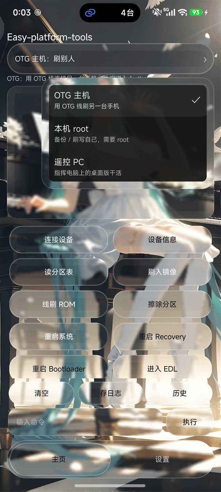

# Easy-platform-tools-GUI v2.14.0 — 弹窗玻璃修好、整块折射、MIUIX 进度条

## 1. 弹窗玻璃取错了参照物（就是"不实时渲染"的原因）

弹窗是 `PopupWindow`，有自己独立的窗口。之前它的玻璃底用的是**主页 root** 当参照物，
`getLocationOnScreen()` 拿到的是主页的位置，于是弹窗里画的是**壁纸左上角**那一块——
和弹窗底下真正的内容完全对不上，看着就像"没渲染"。

现在改成用弹窗自己的内容视图取样，弹窗浮在哪就糊哪一块。

另外顺手修了一个时序问题：浮层弹出的下一帧手指还在屏幕上，抬手会被当成"点到外面"立刻关掉。
现在 `setOutsideTouchable(false)` 先关着，300 ms 后再打开。

## 2. 内层换用外层的折射

以前只有外圈 13 dp 的环做了 1.3× 放大，内层是原样平铺，两者看着是两层。
现在**整块玻璃**都用同一个 1.25× 的放大取样（`lensMatrix`），内层和边缘是一整块透镜，
边缘再叠一层淡淡的白色反光环。

## 3. 进度条换成 MIUIX 样式

| 部位 | 之前 | 现在 |
|---|---|---|
| 轨道 | 系统默认细线 | 12 dp 圆头粗轨道 |
| 已填充 | 无（系统色） | 蓝 #3D7EFF（玻璃/主题色） |
| 未填充 | — | 面板混 18% 文字的灰 |
| 拇指 | 系统小圆 | 20 dp 白色圆球 |
| 高度 | 默认 | 30 dp |

五根滑杆（按键透明度、边框粗细、边框不透明度、玻璃模糊、玻璃浓度）统一换掉。

## 4. 弹窗有不透明度保护

弹窗的玻璃底用固定 0xE8（91%）不透明度，不跟着"玻璃浓度"滑杆变——
否则浓度调到 0 时弹窗会变成全透明，字都看不清。

## 下载

| 文件 | 说明 |
|---|---|
| `EasyPT.apk` | Android 2.14.0，64 KB，minSdk 26（Android 8.0+），versionCode 18 |

桌面版这一版没动（仍是 v2.13.0 里的 2.5.0）。

## 已验证 / 未验证

手机（1440×3200 / 600 dpi）真机验证：

- 弹窗玻璃现在取自身位置，和底下内容对得上
- 弹窗不再"一抬手就消失"
- 滑杆外观、蓝色填充、白色圆头
- 整块折射后的玻璃观感

## 已知取舍

- 折射是"整块放大 1.25×"的近似，不是真正的边缘形变（真折射需要逐像素位移或 AGSL）
- 弹窗不透明度写死 0xE8，没有跟随主题
- 滑杆的轨道高度/拇指大小是固定 dp，不随系统缩放变

## 许可

代码 MIT。platform-tools、MiSans、JetBrains Mono 遵循各自许可，不随本仓库分发。
